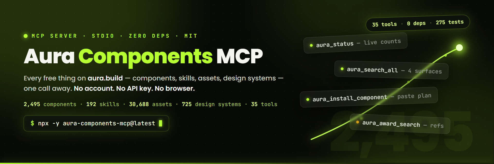
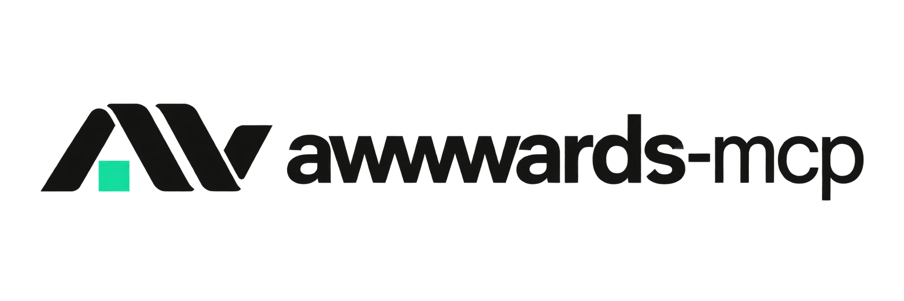

# Aura Components MCP

<div align="center">



<br />

<strong>Turn a design brief into an attributed plan.</strong><br />
Aura finds free components and design systems, and checks motion and responsive evidence when a browser is available.

<br /><br />

<a href="https://www.npmjs.com/package/aura-components-mcp"></a>
<a href="LICENSE"></a>
<a href="package.json">= 22" /></a>
<a href="package.json"></a>
<a href="https://modelcontextprotocol.io"></a>

</div>

### At a glance

<div align="center">

| 🧰 Tools | 📦 Runtime deps | ⚙️ Node | 📄 License | ⭐ Stars |
| :---: | :---: | :---: | :---: | :---: |
| **35** | **0** | **≥ 22** | **MIT** | **13** ([history](https://star-history.com/swastiksingh-dev/Aura-Components-MCP?type=date&legend=top-left)) |

<br />

<a href="https://star-history.com/swastiksingh-dev/Aura-Components-MCP?type=date&legend=top-left"><picture><source media="(prefers-color-scheme: dark)" srcset="https://api.star-history.com/chart?repos=swastiksingh-dev/aura-components-mcp&type=date&theme=dark&legend=top-left"/><source media="(prefers-color-scheme: light)" srcset="https://api.star-history.com/chart?repos=swastiksingh-dev/aura-components-mcp&type=date&legend=top-left"/></picture></a>

<br />

▶ <a href="assets/launch.mp4"><strong>Watch the launch video</strong></a> — ~49 s of typographic motion, not a screen recording.

</div>

> [!NOTE]
> Release candidate prepared as **2.0.0** in this branch; this is **not a published v2 release**. npm `latest` was verified as 1.7.3 on 2026-11-23. The v2 package is available from this source checkout or a local tarball; npm install commands below work after 2.0.0 is published. Catalogue counts change upstream and are intentionally not repeated here; query `aura_status` for current counts.

## What changed on GitHub

- New v2.0.0 launch: README overhaul with **Why Aura** and a stats table.
- Star history: [star-history.com](https://star-history.com/swastiksingh-dev/Aura-Components-MCP?type=date&legend=top-left) dark/light chart and a ⭐ row with 13 stars.
- Added the **Star history** row with the live stars data (13 stars, all visible watch events).
- Added the "What changed on GitHub" changelog itself.
- Updated the launch-video line to the real new clip.
- (Pre-existing: v2.0.0 groundwork — Design Contract planning, research cards, motion evidence, award intelligence, and the five `aura_inspo_*` tools retired.)

<p align="center"><strong>Jump to</strong></p>

<div align="center">

<a href="#why-aura"></a>
<a href="#what-it-does"></a>
<a href="#quick-start"></a>
<a href="#a-first-workflow"></a>
<a href="#tool-index-35"></a>
<a href="#browser-and-evidence-limits"></a>
<a href="#safety-privacy--licensing"></a>
<a href="#development--verification"></a>
<a href="#credits--contributions"></a>

</div>

## Why Aura

Most component tooling starts at the catalogue and hands back a wall of results. Aura starts at your brief, states what it knows, and leaves the rest open.

| Principle | What that means in practice |
| --- | --- |
| **Attribution over confidence** | Every plan field is labeled *stated*, *recommended*, or *open question* — never blended into one confident answer. |
| **Free by default** | Pro or ambiguous entitlements fail closed instead of guessing on your behalf. |
| **Unknowns stay unknown** | `aura_diff` compares known metadata only; it does not invent visual quality or performance. |
| **Evidence, not certification** | Browser checks report what was measured, at the widths they actually ran. |

## What it does

Aura Components MCP is a zero-runtime-dependency Node.js server using MCP over stdio. It exposes Aura's public catalogue (components, skills, assets, design systems) alongside local design and motion planning, curated research cards, Awwwards reference intelligence, and optional browser-based audits. It is an independent project and is not affiliated with Aura.

| Step | What you get |
| --- | --- |
| 🧭 **Plan** | `aura_plan_design` separates your stated facts from labeled recommendations and open questions. |
| 🔎 **Discover** | Search the free catalogue, then compare 2–4 candidates with `aura_diff`; unknowns stay unknown. |
| 🛠️ **Build** | Retrieve a component, install a skill, or scaffold a page with attribution and licence notes in view. |
| ✅ **Verify** | Optional Chrome-based responsive and motion evidence, bounded and explicitly not a certification. |

The current working tree exposes **35 tools**. The exact names and schemas are generated from source in [`docs/v2/tool-definitions.json`](docs/v2/tool-definitions.json); tool behavior and limits are documented in [`docs/v2/TOOL_CONTRACTS.md`](docs/v2/TOOL_CONTRACTS.md).

## Quick start

Requirements: Node.js 22 or newer. For ordinary catalogue and design planning, no browser or account is needed. The client machine needs network access for live catalogue, icon, version, and Awwwards lookups.

### Run from npm

```sh
npx -y aura-components-mcp@2.0.0
```

> **Not on npm yet:** until 2.0.0 is published, `latest` resolves to 1.7.3. Use the source checkout below or install a local tarball.

Or install the executable globally:

```sh
npm install --global aura-components-mcp@2.0.0
aura-components-mcp
```

For MCP clients, configure the command and arguments for their stdio server setting. For example:

```json
{
  "mcpServers": {
    "aura-components": {
      "command": "npx",
      "args": ["-y", "aura-components-mcp@2.0.0"]
    }
  }
}
```

Use an absolute path to `node`/`dist/server.js` or your package manager's resolved executable if your client does not inherit the expected PATH. Client-specific examples are in [SETUP.md](SETUP.md).

### Run from source

```sh
git clone https://github.com/swastiksingh-dev/Aura-Components-MCP.git
cd Aura-Components-MCP
npm install
npm run build
node ./dist/server.js
```

`npm install` installs no runtime dependencies; the package uses Node built-ins and platform-provided `fetch`/WebSocket APIs. The server speaks JSON-RPC/MCP on stdin/stdout; startup messages go to stderr.

## A first workflow

In a connected MCP client, try:

<table>
  <thead>
    <tr><th align="center">Step</th><th align="left">Action</th></tr>
  </thead>
  <tbody>
    <tr><td align="center"></td><td><kbd>aura_status</kbd> — check upstream availability and live catalogue counts.</td></tr>
    <tr><td align="center"></td><td><kbd>aura_plan_design</kbd> with a short brief — get supplied facts, labeled recommendations, and open questions (not generated catalogue results).</td></tr>
    <tr><td align="center"></td><td><kbd>aura_search_components</kbd> or <kbd>aura_search_design_systems</kbd> using the returned retrieval hints.</td></tr>
    <tr><td align="center"></td><td><kbd>aura_diff</kbd> to compare 2–4 free components on known metadata; unknown visual quality and performance stay unknown.</td></tr>
    <tr><td align="center"></td><td>Retrieve a selected result with <kbd>aura_get_component</kbd>, then use <kbd>aura_install_component</kbd> or <kbd>aura_scaffold_page</kbd> for an implementation plan.</td></tr>
  </tbody>
</table>

For award-site references, use `aura_award_search`, `aura_award_inspect`, and `aura_design_blueprint`. For research cards, use `aura_research_search` then `aura_research_read`. For motion planning, `aura_motion_plan` separates stated input from recommendations; `aura_motion_study` can inspect a live page when Chrome is available.

## Tool index (35)

The inventory below is grouped by task. See the generated [tool schema snapshot](docs/v2/tool-definitions.json) for authoritative inputs.

| Workflow | Tools |
| --- | --- |
| 🧭 Design & evidence | `aura_plan_design`, `aura_motion_plan`, `aura_research_search`, `aura_research_read` |
| 🔎 Catalogue status & search | `aura_status`, `aura_search_components`, `aura_search_skills`, `aura_search_assets`, `aura_search_design_systems`, `aura_search_all`, `aura_recommend`, `aura_categories`, `aura_related`, `aura_diff` |
| 🛠️ Retrieve & apply | `aura_get_component`, `aura_get_skill`, `aura_get_design_system`, `aura_bundle`, `aura_bulk_fetch`, `aura_install_component`, `aura_install_skill`, `aura_install_asset`, `aura_use_design_system`, `aura_scaffold_page`, `aura_prompt` |
| 📚 Documentation, icons & version | `aura_docs_plan`, `aura_docs_check`, `aura_icon`, `aura_version` |
| 🏆 Award references & browser evidence | `aura_award_search`, `aura_award_inspect`, `aura_design_blueprint`, `aura_visual_audit`, `aura_motion_study`, `aura_award_index` |

The five `aura_inspo_*` mapping tools from the older v1 surface have been retired. Use catalogue search, award-reference tools, `aura_diff`, or `aura_scaffold_page` instead. `aura_prompt` remains as a compatibility helper.

## Browser and evidence limits

Chrome or Chromium is optional and only needed for live screenshot capture, measured DOM structure/responsive checks, and runtime motion inspection/recording. Set `AURA_CHROME_PATH` if the browser is not found automatically. ffmpeg (or `AURA_FFMPEG_PATH`) is additionally needed to encode motion recordings as WebM; without it, available frame artifacts remain separate.

Browser evidence is bounded and not a full QA certification:

- Responsive mode measures overflow and candidate off-screen bounds at up to seven widths. Candidates are not necessarily defects; fixed controls and nested scrollers can extend outside the viewport. Late-loading assets may shift results after the short settle period.
- Focusable-element counts and reduced-motion preference are observations, not a keyboard or WCAG audit.
- Motion `inspect` samples a single runtime instant. `record` is a bounded scroll tour, not a controlled click/hover/focus interaction capture. Use a separately authorized tool such as optional REA for named actions; Aura does not require or invoke REA.
- Static HTML structure estimates have no measured layout offsets. Reference comparison is not pixel/perceptual parity.

Full scope and evidence provenance: [`docs/v2/MOTION_RESPONSIVE.md`](docs/v2/MOTION_RESPONSIVE.md).

## Safety, privacy & licensing

- Catalogue tools default to free access; Pro or ambiguous component/asset entitlements fail closed. The server does not authenticate to a user account.
- Live queries make outbound requests to public catalogue/registry/CDN/Awwwards endpoints as appropriate. Award and browser URL guards restrict protocols and block private/loopback/link-local/metadata destinations by default; `allowLocal` relaxes loopback blocking only. Do not use it for untrusted URLs.
- Award indexing is local and explicit; it does not crawl on startup. Crawl work is bounded and polite. Index data is stored under `~/.aura-mcp/awards` by default (`AURA_AWARDS_DIR` overrides it).
- Aura catalogue content and assets are not relicensed by this server. Aura's Terms describe assets as all-rights-reserved; check the source page and obtain permission before commercial reuse. A free catalogue result does not mean the content is open source or commercially licensed.
- The server's own code is MIT-licensed. Third-party code, icons, source content, images, and reference designs retain their respective licenses/terms; see [THIRD_PARTY_NOTICES.md](THIRD_PARTY_NOTICES.md) and the source terms.
- Research results are a small curated local seed, not a live literature index. One closed-access source is metadata-only; no papers/PDFs are returned. Claims include provenance and limitations. See [`docs/v2/RESEARCH_LIBRARY.md`](docs/v2/RESEARCH_LIBRARY.md).

## Configuration

The server uses stdio and has no authentication configuration. Optional environment variables and their defaults are defined in [`src/config.mjs`](src/config.mjs); award index and browser variables are described in [SETUP.md](SETUP.md). Do not put secrets in client configuration unless you have a specific reason to override an upstream public key.

## Development & verification

```sh
npm test             # hermetic Node test suite
npm run build        # regenerate dist/server.js and dist/cli.cjs
npm run verify       # live network checks against the built server
npm pack --dry-run --json
```

`npm test` is intended to run without network. `npm run verify` performs live network checks, so its result depends on outbound connectivity and upstream availability. `dist/` is generated; edit source modules and run the build. See [CONTRIBUTING.md](CONTRIBUTING.md), [SECURITY.md](SECURITY.md), and [CHANGELOG.md](CHANGELOG.md).

## Project status

This branch prepares package version 2.0.0, but it has not been published or tagged. Direction for the v2.0 release is in [RELEASE_NOTES.md](docs/v2/RELEASE_NOTES.md). Historical release notes stay in [CHANGELOG.md](CHANGELOG.md); active direction and deferred work are tracked in [DIRECTION.md](DIRECTION.md) and [`docs/v2/PROGRESS.md`](docs/v2/PROGRESS.md).

<hr />

## Credits & contributions

<p align="center"><strong>A big thank-you to the people and projects this work stands on.</strong></p>

### 🌟 Special credit: INSANE0777 and the Awwwards MCP

<div align="center">

<a href="https://github.com/INSANE0777/Awwwards-mcp"><picture><source media="(prefers-color-scheme: dark)" srcset="assets/awwwards-mcp-logo-dark.png"/></picture></a>

<br />

<a href="https://github.com/INSANE0777"></a>
<a href="https://github.com/INSANE0777/Awwwards-mcp"></a>

</div>

**[Afjal (INSANE0777)](https://github.com/INSANE0777) is the author of [Awwwards-mcp](https://github.com/INSANE0777/Awwwards-mcp) — the Awwwards side of this project is his project, and it's the best free, open-source Awwwards reference MCP for AI agents.** Aura's award tools reimplement its site discovery, design-DNA inspection, element galleries, design briefs, local indexing, capture/structure analysis, motion study, and winner tracking for Aura's zero-dependency JavaScript architecture. No substantial source code was copied; the upstream MIT permission notice and the full attribution are preserved in [THIRD_PARTY_NOTICES.md](THIRD_PARTY_NOTICES.md).

| | |
| :--- | :--- |
| 👤 **Creator** | [INSANE0777 (Afjal)](https://github.com/INSANE0777) |
| 🔗 **Repository** | [INSANE0777/Awwwards-mcp](https://github.com/INSANE0777/Awwwards-mcp) |
| 🌐 **Project site** | [awwwards-mcp.vercel.app](https://awwwards-mcp.vercel.app) |
| 📄 **License** | MIT — Copyright (c) 2026 Afjal |

### Built by

Built by [swastiksingh-dev](https://github.com/swastiksingh-dev). The Aura catalogue belongs to Aura and its credited authors; this project is independent. Third-party sources and notices are listed in [THIRD_PARTY_NOTICES.md](THIRD_PARTY_NOTICES.md). The server code is licensed under [MIT](LICENSE).

### Contributing

Contributions are welcome — see [CONTRIBUTING.md](CONTRIBUTING.md). Thanks to INSANE0777 and everyone whose work, research, and feedback has shaped Aura Components MCP.
